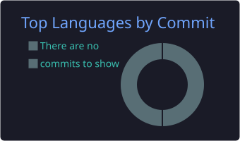
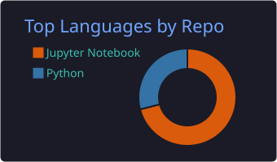
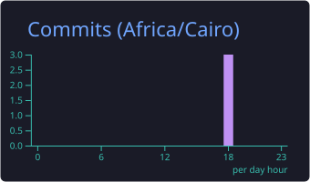

<h1 align="center">Mohamed Gaber</h1>

  <b>AI Engineer</b> · Generative AI · Agentic AI · RAG · Multi-Agent Systems 
  Cairo, Egypt

  
  
  

---

## About

I am an AI Engineer who designs and builds production-oriented applications powered by Large Language Models (LLMs). My work centers on **multi-agent systems, Retrieval-Augmented Generation (RAG), GraphRAG, and NLP pipelines**, built on modern AI frameworks and scalable backend architectures.

I focus on turning complex, real-world problems into reliable intelligent applications across the **legal, banking, healthcare, and knowledge-intensive** domains.

> **Open to AI Engineer opportunities, collaborations, and challenging AI projects.**

---

## Core Expertise

| Area | Focus |
|---|---|
| **Generative AI & LLMs** | LLM applications, prompt engineering, fine-tuning |
| **Agentic AI** | Multi-agent systems, LangGraph, LangChain, MCP |
| **Retrieval Systems** | RAG, GraphRAG, semantic search, embeddings |
| **Machine Learning** | NLP, deep learning, Transformers, PyTorch |
| **Applied AI** | Legal intelligence, banking automation, clinical Q&A |
| **Backend Engineering** | FastAPI, REST APIs, microservices |

---

## Tech Stack

**Languages**

-ED8B00?style=flat&logo=openjdk&logoColor=white)

**AI / Machine Learning**

**RAG & Knowledge Systems**

**Backend & Databases**

**Data & Infrastructure**

---

## Featured Projects

### ⚖️ El Mostashar: Egyptian Criminal Legal Case Solver
*Multi-agent system · Feb – Jun 2026*

An end-to-end system that analyzes Egyptian criminal cases, from raw document ingestion to a structured Arabic judgment.

- Architected a **10-agent framework** in LangGraph covering procedural auditing, multi-layer evidence evaluation, and structured Arabic judgment generation.
- Built a **Neo4j knowledge graph** as the legal memory layer, linking Penal Code articles, Court of Cassation precedents, charges, and case entities for **multi-hop GraphRAG** retrieval.
- Added **FAISS dense retrieval** over an Arabic legal corpus (police minutes, lab reports, defense memos) to supply context to the analytical agents.
- Reduced latency with a **conditional early-exit flow** for procedural nullities and **concurrent node execution** in LangGraph, which helps most on multi-defendant cases.

`Python` `LangGraph` `LangChain` `GraphRAG` `Neo4j` `FAISS` `OpenAI`

### ✈️ Agentic AI Trip Planner
*Multi-tool ReAct agent · Jan 2026*

- Built an autonomous **ReAct agent** in LangGraph that orchestrates **4+ external APIs** (weather, place search, currency conversion, cost calculation) to answer multi-step travel queries.
- Refactored a single-script prototype into a modular **FastAPI + Streamlit** application with consistent logging and exception handling.

`Python` `LangGraph` `FastAPI` `Streamlit`

### 🗄️ LLM-Powered SQL Database Agent
*Text-to-SQL agent · Jan 2026*

- Built a **LangGraph + Groq** workflow that translates natural-language questions into executable SQL and runs them through SQLAlchemy, with results shown in a Streamlit interface.
- Designed a decoupled **FastAPI** backend with dedicated `/generate-sql` and `/execute-sql` endpoints, separating the API from the frontend.
- Supports **MySQL and PostgreSQL**.

`Python` `LangGraph` `LangChain` `Groq` `FastAPI` `Streamlit` `SQLAlchemy` `PostgreSQL` `MySQL`

### 🏥 [Medical Chatbot: RAG-Based Clinical Q&A](https://github.com/mohamedGaber2004/Medical-ChatBot-APP)
*Nov 2025*

A conversational assistant that answers medical questions using context retrieved from a medical knowledge base stored in Pinecone.

`Python` `Flask` `LangChain` `OpenAI` `Pinecone` `Sentence Transformers`

### 🧠 Emotion Classification with DistilBERT
*Oct 2025*

- Ran exploratory data analysis on **16,000 training samples** (class distribution, text-length patterns).
- Fine-tuned `distilbert-base-uncased` with the Hugging Face Trainer API on **6 emotion categories**.
- Reached **93.0% test accuracy** and a **0.928 weighted F1-score**.

`Python` `PyTorch` `Transformers` `Scikit-learn` `Pandas` `NumPy`

### More Work

- [**EGBank OCR App**](https://github.com/mohamedGaber2004/EGBankInternshipProject_OCR_App): OCR application from my banking internship
- [**BERT Fine-Tuning for NER (CoNLL-2003)**](https://github.com/mohamedGaber2004/HuggingFace_BertFintune_Conll2003_NER): Hugging Face token classification
- [**Diabetes Detection**](https://github.com/mohamedGaber2004/ML_DiabetesDetection): classical ML classification
- [**Loan Approval Classification**](https://github.com/mohamedGaber2004/ML_LoanApprovalClassification): classical ML classification
- [**Vegetable Image Recognition**](https://github.com/mohamedGaber2004/DL_VegetableImageRecognition): deep learning image classification

---

## Experience

**AI Developer Intern · EGBank** · New Cairo, Egypt *(Jul 2025)*

- Built an automated **EasyOCR** pipeline and integrated it into an end-to-end document-processing workflow for extracting fields from diverse banking forms.
- Reduced manual data-entry time by approximately **40%**.
- Independently designed, built, and deployed a working proof of concept within a single agile sprint.

**Machine Learning Engineer Intern · Genius Technology Center (GTC)** · Remote *(Aug – Sep 2025)*

- Built an NLP preprocessing pipeline in Python that cleaned and standardized **45,000 news articles** using custom tokenization, lemmatization, and noise filtering.
- Improved dataset reliability by resolving missing entries and removing duplicate records.
- Sped up text normalization with optimized Pandas operations and contributed to architecture discussions on modular, reproducible code.

---

## Education

**B.Sc. in Computer Science** · Sadat Academy for Management Sciences, Maadi, Egypt *(Oct 2022 – Jun 2026)*

---

## Certifications

- **NVIDIA:** Building LLM Applications with Prompt Engineering
- **IBM:** Generative AI Engineering with LLMs (7-course specialization), including Fine-Tuning Transformers
- **DataCamp:** Retrieval-Augmented Generation (RAG) with LangChain
- **Udemy:** Agentic AI Bootcamp (LangGraph & LangChain)
- **DeepLearning.AI:** Natural Language Processing in TensorFlow
- **Stanford University:** Machine Learning, and Supervised Machine Learning: Regression and Classification
- **University of Glasgow:** Generative Pre-trained Transformers (GPT)

---

## GitHub Stats

  
  

  
  

---

## Let's Connect

- **Email:** [mohamedgaberr63@gmail.com](mailto:mohamedgaberr63@gmail.com)
- **LinkedIn:** [linkedin.com/in/mogaber2004](https://www.linkedin.com/in/mogaber2004)
- **Kaggle:** [kaggle.com/mhmedgaber](https://www.kaggle.com/mhmedgaber)
- **GitHub:** [github.com/mohamedGaber2004](https://github.com/mohamedGaber2004)
